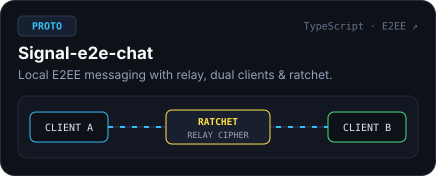
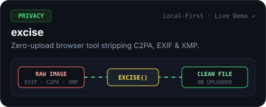
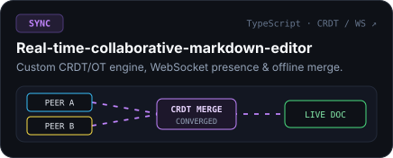
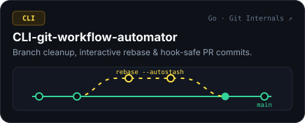
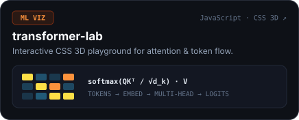
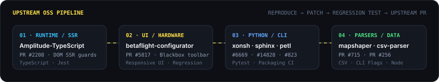

<div align="center">
  <a href="https://sshnox.vercel.app/">
    <picture>
      <source media="(prefers-color-scheme: dark)" srcset="./assets/hero-dark.svg">
      <source media="(prefers-color-scheme: light)" srcset="./assets/hero-light.svg">
      
    </picture>
  </a>

  <p>
    <a href="https://sshnox.vercel.app/"></a>
    <a href="https://www.linkedin.com/in/sshnox/"></a>
    <a href="https://github.com/pulls?q=is%3Apr+author%3Asshnox"></a>
    <a href="https://github.com/sshnox?tab=repositories"></a>
  </p>
</div>

<br>

## `/about` · Live Engineering Console

I'm **Shoaib Shah** (`@sshnox`) — a **BS Data Science student**, tech-focused entrepreneur, and independent builder. I turn concrete problems into fast, **local-first software**, explore **AI, data, and automation**, and ship test-backed fixes upstream.

<div align="center">
  <picture>
    <source media="(prefers-color-scheme: dark)" srcset="./assets/telemetry-dark.svg">
    <source media="(prefers-color-scheme: light)" srcset="./assets/telemetry-light.svg">
    
  </picture>
</div>

<br>

## `~/shipped` · Interactive Blueprints

<table>
  <tr>
    <td width="50%" align="center">
      <a href="https://github.com/sshnox/Signal-e2e-chat">
        <picture>
          <source media="(prefers-color-scheme: dark)" srcset="./assets/cards/signal-dark.svg">
          <source media="(prefers-color-scheme: light)" srcset="./assets/cards/signal-light.svg">
          
        </picture>
      </a>
    </td>
    <td width="50%" align="center">
      <a href="https://github.com/sshnox/excise">
        <picture>
          <source media="(prefers-color-scheme: dark)" srcset="./assets/cards/excise-dark.svg">
          <source media="(prefers-color-scheme: light)" srcset="./assets/cards/excise-light.svg">
          
        </picture>
      </a>
    </td>
  </tr>
  <tr>
    <td width="50%" align="center">
      <a href="https://github.com/sshnox/Real-time-collaborative-markdown-editor">
        <picture>
          <source media="(prefers-color-scheme: dark)" srcset="./assets/cards/crdt-dark.svg">
          <source media="(prefers-color-scheme: light)" srcset="./assets/cards/crdt-light.svg">
          
        </picture>
      </a>
    </td>
    <td width="50%" align="center">
      <a href="https://github.com/sshnox/CLI-git-workflow-automator">
        <picture>
          <source media="(prefers-color-scheme: dark)" srcset="./assets/cards/gitcli-dark.svg">
          <source media="(prefers-color-scheme: light)" srcset="./assets/cards/gitcli-light.svg">
          
        </picture>
      </a>
    </td>
  </tr>
  <tr>
    <td width="50%" align="center">
      <a href="https://github.com/sshnox/transformer-lab">
        <picture>
          <source media="(prefers-color-scheme: dark)" srcset="./assets/cards/transformer-dark.svg">
          <source media="(prefers-color-scheme: light)" srcset="./assets/cards/transformer-light.svg">
          
        </picture>
      </a>
    </td>
    <td width="50%" align="center">
      <a href="https://github.com/sshnox/chatmeter">
        <picture>
          <source media="(prefers-color-scheme: dark)" srcset="./assets/cards/extensions-dark.svg">
          <source media="(prefers-color-scheme: light)" srcset="./assets/cards/extensions-light.svg">
          
        </picture>
      </a>
    </td>
  </tr>
</table>

<details>
<summary><strong>More shipped utilities (Data Hygiene · 3D · Analytics · Focus)</strong></summary>
<br>

| Project | Domain | Summary |
| :--- | :--- | :--- |
| [`company-name-cleaner`](https://github.com/sshnox/company-name-cleaner) | Data Hygiene | Browser-local CSV & company name normalizer before CRM import |
| [`github-stats`](https://github.com/sshnox/github-stats) | Analytics | Public GitHub API dashboard for stars, forks, languages & commit cadence |
| [`landmarks-3d`](https://github.com/sshnox/landmarks-3d) | WebGL / 3D | Interactive Three.js gallery of four procedurally generated landmarks |
| [`taskbell-clock`](https://github.com/sshnox/taskbell-clock) | Utility | Minimal standalone task clock & countdown timer |
| [`Claude-Usage-Tracker-v2.1.0`](https://github.com/sshnox/Claude-Usage-Tracker-v2.1.0) | Extension | Inline Claude session, weekly & Opus usage tracker (no API keys) |

</details>

<br>

## `git log --upstream` · Open-Source Engineering

<div align="center">
  <picture>
    <source media="(prefers-color-scheme: dark)" srcset="./assets/oss-pipeline-dark.svg">
    <source media="(prefers-color-scheme: light)" srcset="./assets/oss-pipeline-light.svg">
    
  </picture>
</div>

<br>

<details>
<summary><strong>Inspect full upstream PR ledger (10+ active repositories)</strong></summary>
<br>

| Repository | Technical Scope | PR |
| :--- | :--- | :--- |
| `amplitude/Amplitude-TypeScript` | Guard DOM tracking listeners (`document`, `addEventListener`, `history`) during SSR | [#2208](https://github.com/amplitude/Amplitude-TypeScript/pull/2208) |
| `betaflight/betaflight-configurator` | Responsive mobile Blackbox Viewer toolbar, compact action menu & regression suite | [#5817](https://github.com/betaflight/betaflight-configurator/pull/5817) |
| `petl-developers/petl` | Clean-environment wheel & sdist installation validation CI job | [#823](https://github.com/petl-developers/petl/pull/823) |
| `xonsh/xonsh` | Preserve undecodable raw-byte selections when system clipboard encoding fails | [#6669](https://github.com/xonsh/xonsh/pull/6669) |
| `sphinx-doc/sphinx` | Machine-readable LibreJS / SPDX license metadata on generated JS assets | [#14828](https://github.com/sphinx-doc/sphinx/pull/14828) |
| `mbloch/mapshaper` | Ignore quoted punctuation & escaped quotes during CSV delimiter detection | [#715](https://github.com/mbloch/mapshaper/pull/715) |
| `mafintosh/csv-parser` | Forward CLI `--quote` and `--escape` options into parser + process-level tests | [#256](https://github.com/mafintosh/csv-parser/pull/256) |
| `jrnl-org/jrnl` | Keep CLI operational on `EACCES` / `EROFS` read-only config filesystems | [#2142](https://github.com/jrnl-org/jrnl/pull/2142) |
| `ota-meshi/eslint-plugin-markdown-links` | Recognize legacy HTML named anchors (`<a name>`) and `#top` fragments | [#156](https://github.com/ota-meshi/eslint-plugin-markdown-links/pull/156) |
| `trekhleb/javascript-algorithms` | Cache binary tree subtree heights across mutations & AVL removals | [#2254](https://github.com/trekhleb/javascript-algorithms/pull/2254) |

</details>

<br>

## House Rules

```text
01. Local-first by default   — if it can run in the browser or CLI without a backend, it should.
02. Tests prove the fix      — every bugfix starts with a failing regression test on unchanged main.
03. Small, sharp tools       — solve one real workflow cleanly rather than shipping a bloated suite.
04. Build in public          — readable diffs, honest validation notes, and automated telemetry.
```

<details>
<summary><strong>Architecture &amp; Rust live telemetry engine</strong></summary>
<br>

- **18 Custom Theme-Adaptive SVGs** — Pure CSS keyframe animations (GitHub-safe, zero JS, instant dark/light switching via `<picture>`).
- **[`Cargo.toml`](./Cargo.toml) &amp; [`src/main.rs`](./src/main.rs)** — Compiled **Rust 2024 edition** telemetry generator (`ureq 3.5` with pure-Rust `rustls`, `serde`, `chrono`, and built-in `cargo test` unit tests) querying the GitHub REST API for live repos, stars, followers, open PRs, language ratios, and the **14-day public event cadence sparkline**.
- **[`scripts/update-profile.workflow.yml`](./scripts/update-profile.workflow.yml)** — Daily scheduled GitHub Action (`06:00 UTC`) with Cargo caching (`Swatinem/rust-cache@v2`) that runs `cargo test` + `cargo run --release` and commits updated SVGs only on diff.

</details>

---

<p align="center">
  <sub>∆ · <strong>Curious by nature. Builder by choice.</strong> · <a href="https://sshnox.vercel.app/">sshnox.vercel.app</a></sub>
</p>
