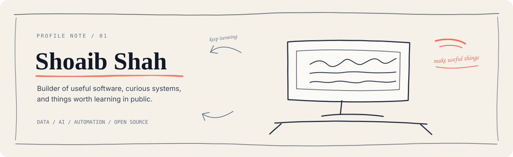
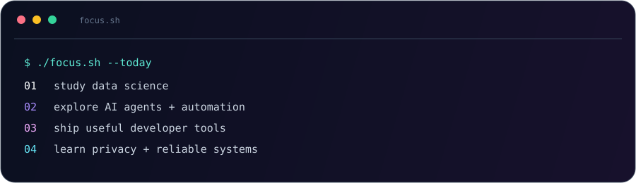

 

 

`01 / PROFILE` &nbsp;&nbsp; `02 / SELECTED WORK` &nbsp;&nbsp; `03 / CURRENT FOCUS` &nbsp;&nbsp; `04 / TOOLKIT` &nbsp;&nbsp; `05 / CONNECT`

---

## 01 / Profile

I’m **Shoaib Shah** — a data science student and growth-minded builder working at the intersection of **software, data, AI, automation, and open source**.

My default mode is simple: find a useful problem, build a clear solution, learn from the edges, and ship the next version.

### Build useful things. Learn in public. Keep iterating.

<table>
<tr>
<td width="33%" align="center">

**BUILD** 
Small software with a real use case.

</td>
<td width="33%" align="center">

**LEARN** 
Data, AI, systems, and security.

</td>
<td width="33%" align="center">

**SHARE** 
Open source, experiments, and lessons.

</td>
</tr>
</table>

## 02 / Selected work

<table>
<tr>
<td width="50%" valign="top">

### `SECURITY / MESSAGING`

## [Signal E2E Chat](https://github.com/sshnox/Signal-e2e-chat)

An end-to-end encrypted messaging project exploring secure session setup, ratcheting, safety numbers, and relay design.

`Cryptography` · `Node.js` · `WebSockets`

</td>
<td width="50%" valign="top">

### `BROWSER / AI TOOLS`

## [Claude Usage Tracker](https://github.com/sshnox/Claude-Usage-Tracker-v2.1.0)

A Chrome extension that shows Claude usage limits inside the chat experience without API keys or third-party telemetry.

`Chrome Extension` · `JavaScript` · `AI`

</td>
</tr>
<tr>
<td width="50%" valign="top">

### `PRIVACY / IMAGES`

## [Excise](https://github.com/sshnox/excise)

A privacy-focused image metadata remover for C2PA, EXIF, and XMP data.

`Privacy` · `Images` · `Metadata`

</td>
<td width="50%" valign="top">

### `DATA / WORKFLOWS`

## [Company Name Cleaner](https://github.com/sshnox/company-name-cleaner)

A client-side utility for turning messy company names into cleaner names for CRM and outreach workflows.

`Data Cleaning` · `JavaScript` · `Lead Ops`

</td>
</tr>
<tr>
<td width="50%" valign="top">

### `DATA / EXPORT`

## [Post Engagement Exporter](https://github.com/sshnox/post-engagement-exporter)

A tool for turning social post engagement data into a more useful format for analysis and follow-up.

`Export` · `Automation` · `Data`

</td>
<td width="50%" valign="top">

### `AI / KNOWLEDGE`

## [Awesome LLM Apps](https://github.com/sshnox/awesome-llm-apps)

A curated collection of runnable AI agent and RAG applications to explore, customize, and ship.

`LLMs` · `RAG` · `Agents`

</td>
</tr>
</table>

[**Browse every public repository →**](https://github.com/sshnox?tab=repositories)

## 03 / Current focus

## 04 / Toolkit

### Languages, systems & workflow

### AI, coding & agent workspace

`AI & LLMs` &nbsp; `Agent Workflows` &nbsp; `Automation` &nbsp; `Data Pipelines` &nbsp; `Browser Tools` &nbsp; `Developer Experience`

## 05 / Connect

If you’re building something thoughtful around **AI, data, automation, developer tools, or open source**, I’d be happy to hear about it.

  

Build → Learn → Contribute → Repeat.

